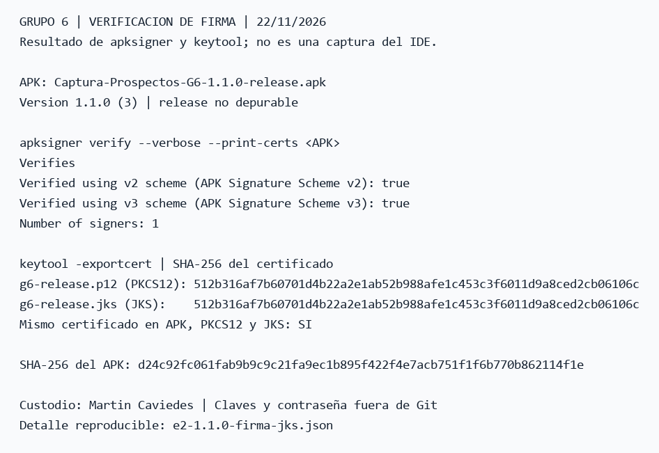

# Captura de Prospectos — Grupo 6

Aplicación Android para registrar personas interesadas en estudiar en Duoc UC durante ferias, visitas a establecimientos y otras actividades de captación en terreno.

El proyecto aborda el caso **Inscripción de potenciales clientes**, de la asignatura Desarrollo de Aplicaciones Móviles. Reúne los datos de contacto, los intereses académicos y el contexto de cada inscripción para facilitar el trabajo del equipo de captación, incluso sin conexión a internet.

**[Descargar APK final E2 1.1.0](https://github.com/MartinCaviedes/Captura-Prospectos-G6/releases/download/e2-1.1.0/Captura-Prospectos-G6-1.1.0-release.apk)** · [Instalación y firma](docs/RELEASE_DISTRIBUTION.md) · [Estado de entrega](docs/ENTREGA_E2_1_1_0.md) · [Swagger](https://13.58.183.187/docs/index.html) · [Documentación](docs/README.md)

La release E2 utiliza el backend académico de AWS. La [versión E1 anterior](https://github.com/MartinCaviedes/Captura-Prospectos-G6/releases/tag/e1-demo-1.0.1) permanece disponible; los datos locales de debug y release pertenecen a instalaciones independientes.

**SRS de entrega, revisión 1.5:** [descargar Word](docs/entrega/SRS_Captura_de_Prospectos_G6.docx?raw=true) · [consultar Markdown](docs/SRS.md). Ambas versiones distinguen las funciones incluidas de las ampliaciones previstas.

## Caso de negocio

En una actividad de admisión se necesita vincular a cada persona interesada con sus preferencias de estudio y con el evento en que fue atendida. La aplicación busca reducir la transcripción manual, validar la información durante su ingreso y conservar registros que luego puedan revisarse y resumirse.

| Participante | Función en el proceso |
|---|---|
| Captador | Seleccionar un evento, registrar prospectos y revisar sus capturas y resultados. |
| Supervisor | Administrar eventos y asignaciones, consultar registros y revisar resultados dentro de su ámbito. |
| Administrador | Habilitar cuentas registradas y gestionar su estado, rol y sedes autorizadas. |
| Prospecto | Proporcionar sus datos, intereses y consentimiento; no necesita una cuenta en la app. |

La sede del evento y las sedes preferidas para estudiar son datos distintos. Cada prospecto puede expresar **hasta tres carreras ordenadas por prioridad**, junto con las preferencias previstas en el formulario de admisión.

## Qué permite hacer

- **Acceso y registro de usuarios:** solicitar una cuenta remota; el administrador la habilita y asigna rol/sedes. El login se valida en backend mediante API Gateway y JWT RS256. CAPTADOR/SUPERVISOR pueden continuar localmente hasta 12 horas desde el login verificado, con autorización cifrada y sin contraseña local; reiniciar el dispositivo exige conexión. [Alcance de sesión offline](docs/OFFLINE_SESSION_VALIDATION.md).
- **Gestión real de eventos y contextos:** crear, editar y seleccionar eventos de captación por sede (tanto para supervisores como para captadores en sus sedes autorizadas), sin depender de eventos ficticios precargados.
- **Formulario de admisión F2027 con validaciones por campo:** registrar datos personales, RUT con dígito verificador (módulo 11), correo, teléfono, actividad actual, establecimiento y hasta tres carreras priorizadas del catálogo Admisión Duoc UC 2027.
- **Consentimiento y sincronización persistente:** guardar fichas y operaciones pendientes en Room con SQLCipher/Android Keystore; enviar altas, ediciones y anulaciones con reintentos idempotentes y permisos revalidados. La cola continúa con la app abierta y acceso vigente. Conflictos y fichas anteriores se conservan para revisión. [Alcance y límites](docs/PROSPECT_SYNC_CONTRACT.md).
- **Bandeja, detalle, edición y anulación:** consultar registros reales filtrados por rol/sede, estado y búsqueda textual, editar con control optimista de versión y anular con motivo auditado.
- **Recursos nativos integrados:** escanear códigos QR con CameraX y ML Kit para proponer el RUT, adquirir ubicación candidata por GPS (`LocationManager`) y observar el estado de conectividad en tiempo real (`ConnectivityManager`).
- **API externa de ubicación:** después de confirmar GPS reciente, consultar opcionalmente la localidad mediante BigDataCloud y, por separado, intentar obtener calle/número con el geocodificador de Android. Ambos muestran referencias aproximadas con aviso previo y alternativa ante fallo. Describen el punto de captura, sin rellenar el domicilio del prospecto. [Contrato y evidencia](docs/EXTERNAL_GEOCODING_CONTRACT.md).
- **Resumen y métricas reales:** consultar gráficos y estadísticas calculados directamente desde los registros almacenados por evento y rango de fechas, y alternar entre modo claro y oscuro desde Perfil.

El recorrido habitual es **bienvenida → inicio de sesión o registro de cuenta → selección o creación de evento → captura con consentimiento y guardado → consulta de bandeja y resumen**. La información guardada permanece en el dispositivo al cerrar la sesión o reiniciar la aplicación.

## Alcance de las entregas

| Entrega | Enfoque |
|---|---|
| **E1 · aplicación local** | Formulario F2027, Room cifrado, bandeja de registros, eventos, métricas, cámara QR, GPS y conectividad real en dispositivo. |
| **E2 y evaluación final · aplicación integrada** | Registro/autenticación y permisos, catálogo académico local versionado, microservicios Spring Boot con PostgreSQL, sincronización persistente, API externa, perfil local y distribución firmada. |

Consulta los criterios completos en [Entregas](docs/ENTREGAS.md) y [SRS](docs/SRS.md).

## Uso de la aplicación

1. Abre la aplicación y pulsa **Comenzar**.
2. En la pantalla de acceso:
   - Si aún no tienes cuenta, pulsa **¿No tienes cuenta? Crear cuenta**, ingresa nombre, correo y contraseña y pulsa **Solicitar cuenta**. La solicitud queda pendiente; el administrador debe habilitarla y asignar rol/sedes.
   - Si ya tienes una cuenta remota habilitada, ingresa tu usuario o correo y contraseña. El Administrador entra a gestión de usuarios sin elegir evento; Captador/Supervisor continúan al contexto de trabajo. El acceso requiere el backend actualizado; no usa cuentas locales como respaldo tras un rechazo.
   - Sin red, si existe una autorización local vigente de este mismo arranque del dispositivo, puedes pulsar **Continuar sin conexión**. Al recuperar red se revalida el acceso; si el JWT ya no está disponible, se solicita login. Los envíos permanecen bloqueados hasta validarlo.
3. En **Tu punto de partida**, selecciona un evento existente o pulsa **Nuevo evento** para registrar una nueva actividad en tu sede (puedes usar **Autocompletar jornada de hoy** para rellenar el horario de la jornada actual).
4. Accede a **Inicio**, **Registros**, **Resumen** y **Perfil** para capturar prospectos, editar o anular fichas y consultar estadísticas reales.

Para probar la cámara, muestra un [QR compatible o no compatible](docs/fixtures/qr/README.md) frente al escáner. El primero propone el RUT para confirmación del usuario; el segundo verifica el rechazo seguro y permite continuar con ingreso manual.

## Tecnologías y arquitectura

| Área | Tecnologías y responsabilidad |
|---|---|
| Interfaz | Kotlin, Jetpack Compose, Material 3 y animaciones de transición (`Crossfade`, `AnimatedVisibility`, `animateContentSize`). |
| Estado | ViewModel, StateFlow y Coroutines para estado inmutable y acciones unidireccionales (MVVM). |
| Dominio | Reglas de validación centralizadas, consentimiento, preferencias académicas y contratos en Kotlin. |
| Almacenamiento local | Room 2.8.5 sobre SQLite, con SQLCipher 4.19.1 para cifrado y Android Keystore para proteger la clave AES-256-GCM. |
| Comunicación remota | Retrofit 2.11.0 + OkHttp 4.12.0 + Gson hacia el `api-gateway` con autenticación Bearer JWT. |
| Backend y BD remota | Java 21, Spring Boot 3.5.16 (`api-gateway`, `users-service`, `prospects-service`), Spring Security OAuth2/JWT RS256 y PostgreSQL. |
| Cámara, GPS y red | CameraX + ML Kit Barcode Scanning (modelo incluido), `LocationManager` y `ConnectivityManager`. |
| Construcción y pruebas | Gradle Wrapper, Maven Wrapper, JUnit, AndroidX Test y pruebas de integración Spring Boot. |

El flujo principal en Android es **pantalla → ViewModel → repositorio → Room cifrado (+ sincronización Retrofit con API Gateway)**. La base de datos local SQLite/Room se conserva como fuente primaria offline-first para garantizar que ningún fallo de red provoque pérdida de capturas. [Más sobre la arquitectura](docs/ARCHITECTURE.md).

## Ejecutar desde el código

Para clonar el hito integrado en `main`:

```powershell
git clone https://github.com/MartinCaviedes/Captura-Prospectos-G6.git
cd Captura-Prospectos-G6
git checkout main
```

### Android

Abre la carpeta **`android/`** en Android Studio, configura **SDK 37** y el **JDK 25** requerido por el daemon de Gradle, y selecciona la variante **`demoDebug`**.

Para compilar y ejecutar las pruebas unitarias desde la raíz del repositorio:

```powershell
cd android
.\gradlew.bat :app:testDemoDebugUnitTest :app:assembleDemoDebug --console=plain
```

La APK se genera en `android/app/build/outputs/apk/demo/debug/app-demo-debug.apk`. La compilación predeterminada conecta el emulador al gateway local `http://10.0.2.2:8080/`; necesita el backend de la siguiente sección.

Para conectar una compilación debug al backend académico desplegado, sin depender del PC, desde `android/`:

```powershell
.\gradlew.bat :app:assembleDemoDebug -Pg6ApiBaseUrl=https://13.58.183.187/ --console=plain
```

Instalar con **Run** de Android Studio o `adb install -r app/build/outputs/apk/demo/debug/app-demo-debug.apk`. Para usar la release firmada, descargarla del enlace superior. La instancia AWS debe estar encendida y la cuenta habilitada; el registro no concede permisos automáticamente. Más detalles en la [guía Android](android/README.md).

### Backend (`api-gateway`, `users-service`, `prospects-service`)

Los tres microservicios Spring Boot están en [`backend/`](backend/README.md):
- **`api-gateway` (`:8080`):** Punto de entrada único, validación JWT RS256, rate-limit de login y enrutamiento hacia usuarios y prospectos.
- **`users-service` (`:8081`):** Usuarios persistidos en JPA/PostgreSQL, contraseñas BCrypt y emisión de JWT RS256 (`/api/v1/auth/login`, `/api/v1/auth/logout`, `/api/v1/me`, `/api/v1/users`).
- **`prospects-service` (`:8082`):** Persistencia y CRUD de prospectos en PostgreSQL (`/api/v1/prospects`), control de acceso por rol/sede, unicidad activa `(rut, eventId)` y anulación auditada.

En Windows, con **PowerShell 7 y Java 21**, preparar y ejecutar el backend local con H2 persistente desde la raíz del repositorio:

```powershell
cd backend
.\scripts\prepare-local.ps1 -UseDemoCredentials
.\mvnw.cmd verify
.\scripts\run-local.ps1
```

Swagger local: `http://localhost:8080/docs/index.html`. La [guía Windows](docs/LOCAL_WINDOWS_SETUP.md) identifica credenciales ficticias y configuración de IntelliJ; no son las credenciales de AWS. Un entorno existente conserva claves y contraseñas. Detener solo los procesos de este lanzador con `.\scripts\run-local.ps1 -Stop`.

Para PostgreSQL y despliegue, consultar la [guía del backend](backend/README.md) y la [operación en EC2](backend/deploy/ec2/README.md). En AWS, gateway y Swagger se publican por HTTPS en 443; 8080/8081/8082 y PostgreSQL son internos. El puerto 80 atiende redirección y validación del certificado.

## Endpoints utilizados

Base propia desplegada: **`https://13.58.183.187/api/v1`**. En desarrollo: `http://localhost:8080/api/v1`. Las operaciones protegidas requieren Bearer JWT y permisos de rol/sede. [Contrato completo](docs/openapi/backend.openapi.json) · [Swagger UI](https://13.58.183.187/docs/index.html).

| Método | Ruta relativa a la base | Uso |
|---|---|---|
| POST | `/auth/register` | Solicitar una cuenta pendiente. |
| POST | `/auth/login` · `/auth/logout` | Autenticación y cierre de sesión. |
| GET | `/me` | Validar identidad y permisos vigentes. |
| GET / POST | `/users` | Listar o crear cuentas según permisos. |
| GET | `/users/{id}` | Consultar cuenta autorizada. |
| PATCH | `/users/{id}/access` · `/users/{id}/estado` | Gestionar rol, sedes y estado. |
| GET | `/admin/sites` | Consultar sedes administrables. |
| GET / POST | `/prospects` | Consultar o crear prospectos autorizados. |
| GET / PUT | `/prospects/{id}` | Consultar o actualizar con revisión esperada. |
| POST | `/prospects/{id}/cancel` | Anular con motivo y auditoría. |
| PUT | `/prospects/sync/{id}` | Enviar revisiones idempotentes de la cola Android. |

**API externa:** `GET https://api.bigdatacloud.net/data/reverse-geocode-client?latitude={lat}&longitude={lon}&localityLanguage=es`. Retrofit consulta directamente desde el teléfono, por acción explícita con GPS actual confirmado. Muestra localidad/ciudad, región y país; no envía JWT ni datos de la ficha y no completa el domicilio del prospecto. La integración no requiere clave de API. El intento separado de calle/número utiliza Android Geocoder y puede no devolver dirección. [Contrato, privacidad y límites](docs/EXTERNAL_GEOCODING_CONTRACT.md).

## Firma y evidencia de distribución

La APK **1.1.0 (3)** es release no depurable, firmada con alias `g6-release` y verificada con `apksigner` (v2/v3). El certificado público y las sumas SHA-256 están en los [adjuntos de la release final](https://github.com/MartinCaviedes/Captura-Prospectos-G6/releases/tag/e2-1.1.0). [Evidencia técnica de la APK](docs/evidencias/e2-1.1.0-release-verification.json).

La clave principal es `g6-release.p12` y se conserva una copia **`g6-release.jks`** con la misma clave y certificado. Ubicación privada de ambas: `C:\Workspace\Projects\Academic\AppMovil\Docs\firma-release\acceso-privado\`; custodio: **Martín Caviedes**. La contraseña también queda fuera de Git. Estos archivos no se adjuntan al repositorio ni a la release pública; el certificado público permite verificar la firma sin exponer la clave. Una eventual entrega de la llave al docente debe realizarse por el canal privado de evaluación.



La imagen resume resultados reales de herramientas, no una captura del IDE. [Verificación reproducible](docs/evidencias/e2-1.1.0-firma-jks.json) · [Procedimiento de firma](docs/RELEASE_DISTRIBUTION.md).

## Pruebas y colaboración

La [verificación de cobertura](docs/COVERAGE_VALIDATION.md) identifica alcance e informes: **60 tests backend, 268 JVM Android y 143 instrumentados**. Cobertura de líneas por servicio: gateway **98,28 %**, usuarios **84,35 %**, prospectos **98,00 %**; lógica Android **87,10 %**, separada de presentación y generado. [Estado y pruebas manuales](docs/ENTREGA_E2_1_1_0.md).

La participación del grupo se conserva en el [historial de commits](https://github.com/MartinCaviedes/Captura-Prospectos-G6/commits/main/) y los [PR integrados](https://github.com/MartinCaviedes/Captura-Prospectos-G6/pulls?q=is%3Apr+is%3Amerged). `main` identifica el hito publicado y `develop` la integración.

## Organización del repositorio

```text
android/                  Aplicación Android (Kotlin, Jetpack Compose, Room/SQLCipher, Retrofit)
  app/src/main/           Dominio, datos locales, cliente remoto Retrofit, pantallas y recursos
  app/src/test/           Pruebas unitarias JVM
  app/src/androidTest/    Pruebas instrumentadas y de interfaz
  app/schemas/            Esquemas exportados de Room (v1 a v5)
backend/                  Microservicios Spring Boot (Java 21, Maven)
  api-gateway/            Gateway reactivo y validación JWT (:8080)
  users-service/          Servicio de usuarios, roles y autenticación JWT (:8081)
  prospects-service/      Servicio de prospectos y persistencia PostgreSQL (:8082)
docs/                     Requisitos, contratos, arquitectura, auditorías y evidencias
```

## Documentación del proyecto

| Para consultar | Documento |
|---|---|
| Requisitos y alcance por entrega | [SRS Markdown](docs/SRS.md) · [SRS Word](docs/entrega/SRS_Captura_de_Prospectos_G6.docx?raw=true) · [Entregas](docs/ENTREGAS.md) |
| Campos, carreras y preferencias | [Formulario de admisión](docs/FORMULARIO_ADMISION_2027.md) |
| Capas y decisiones técnicas | [Arquitectura](docs/ARCHITECTURE.md) · [Diseño](docs/DESIGN.md) |
| Datos, contexto y protección | [Modelo local](docs/LOCAL_MODEL.md) · [Contexto demo](docs/DEMO_CONTEXT.md) · [Seguridad](docs/SECURITY.md) |
| Construcción y pruebas | [Guía Android](android/README.md) · [Evidencia técnica](docs/ANDROID_BASELINE.md) · [QA y pendientes](docs/ROUND4_QA.md) |
| Apodo y foto en este dispositivo | [Personalización del perfil](docs/PROFILE_PERSONALIZATION.md) |
| API implementada y pruebas desde navegador | [OpenAPI y Swagger UI](docs/SWAGGER_VALIDATION.md) |
| Historial y documentación completa | [Changelog](docs/CHANGELOG.md) · [Índice](docs/README.md) |

## Equipo

Grupo 6: [Martín Caviedes](https://github.com/MartinCaviedes), [Jeremy Hanglin](https://github.com/JeremyDylan122) y [Sebastián Diaz](https://github.com/Sebastianidm).

Proyecto académico de Desarrollo de Aplicaciones Móviles, Duoc UC Viña del Mar.
